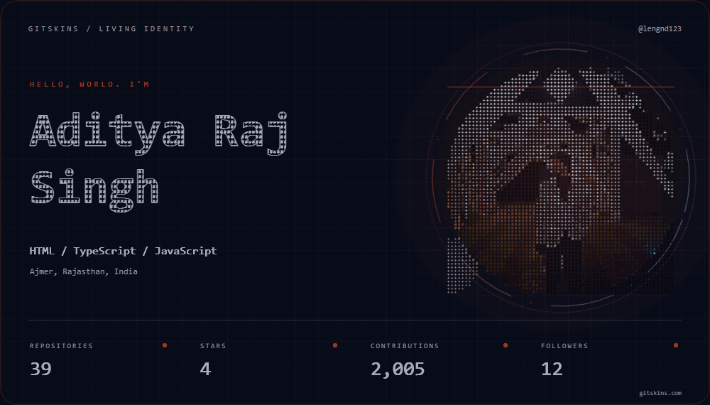
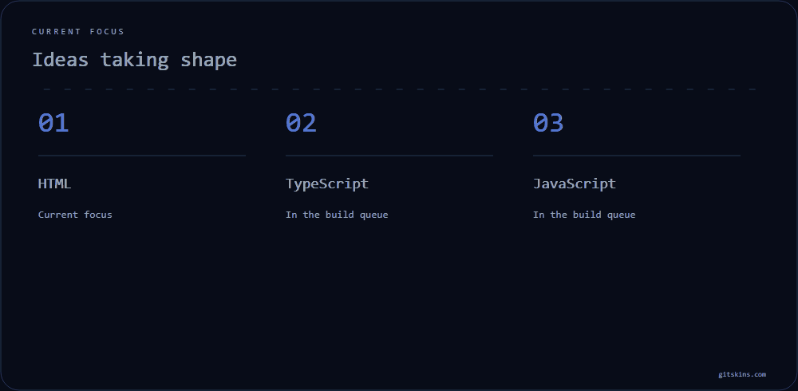
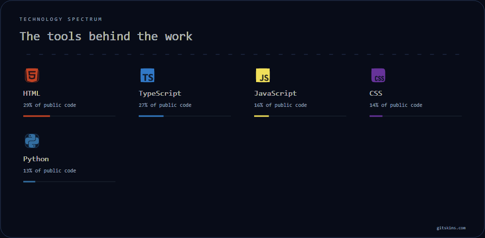
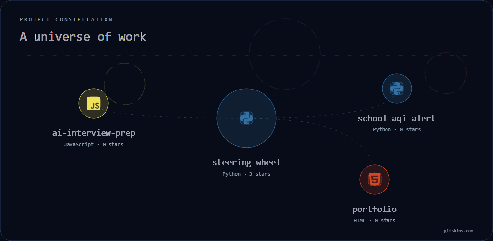
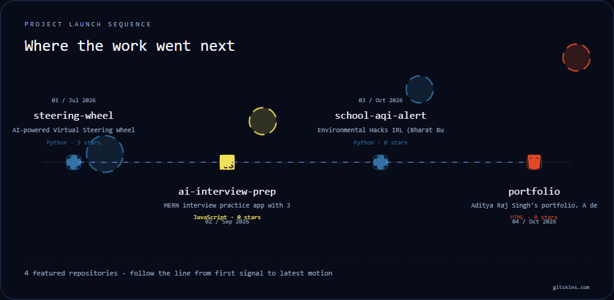
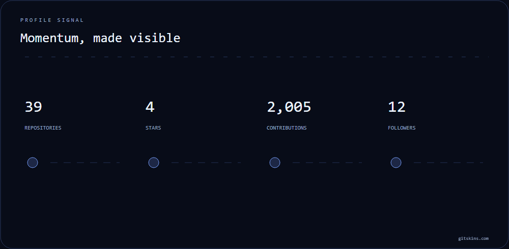
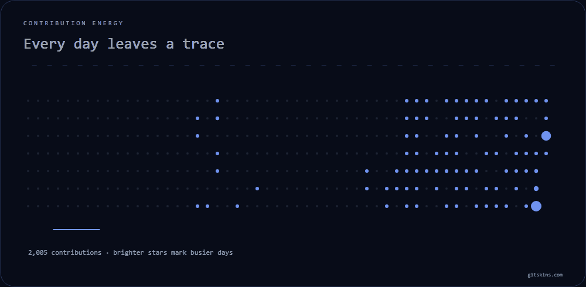
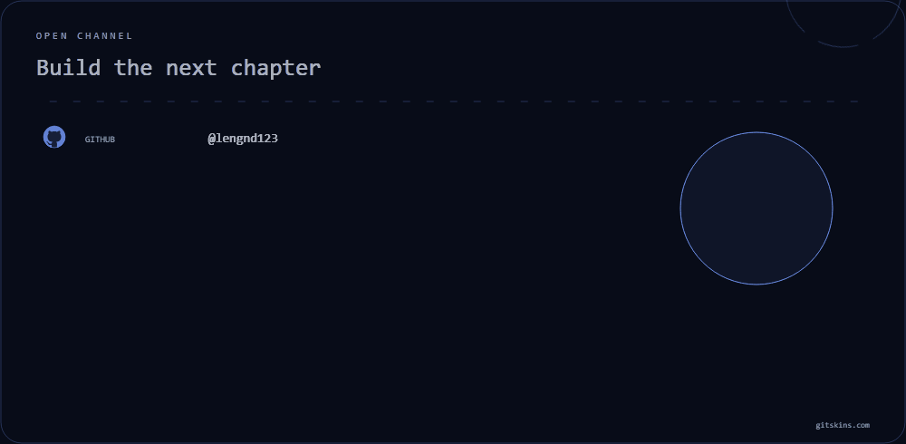

 

WOW PROFILE · LENGND123 · LIVE
 

<picture>
  <source media="(prefers-color-scheme: dark)" srcset="profile/hero-dark-smooth.gif" />
  <source media="(prefers-color-scheme: light)" srcset="profile/hero-light-smooth.gif" />
  
</picture>

<strong>Full-stack and AI/ML developer</strong> · Ajmer, Rajasthan

Building useful things and sharing the work in public.

<a href="https://github.com/LENGND123">GitHub</a>

✦ ───────────────────────────── ✦

<h2>Identity, with signal</h2>

<table width="100%">
<tr>
<td width="62%" valign="top">

Building useful things and sharing the work in public.

<strong>Focus:</strong> <code>HTML</code> · <code>TypeScript</code> · <code>JavaScript</code>

Full-stack apps, small ML tools, and work shared in public.

</td>
<td width="38%" valign="top">

<code>LIVE SIGNAL</code>

<strong>39</strong> repos <strong>4</strong> stars <strong>2,005</strong> contributions <strong>12</strong> followers

</td>
</tr>
</table>

✦ ───────────────────────────── ✦

<h2>What moves the work</h2>

<picture>
  <source media="(prefers-color-scheme: dark)" srcset="profile/highlights-dark-smooth.gif" />
  <source media="(prefers-color-scheme: light)" srcset="profile/highlights-light-smooth.gif" />
  
</picture>

Positioning is useful when the proof is close behind it.

✦ ───────────────────────────── ✦

<h2>The tools behind the signal</h2>

<picture>
  <source media="(prefers-color-scheme: dark)" srcset="profile/stack-dark-smooth.gif" />
  <source media="(prefers-color-scheme: light)" srcset="profile/stack-light-smooth.gif" />
  
</picture>

HTML · TypeScript · JavaScript · CSS · Python · chosen for the work, not the trend

✦ ───────────────────────────── ✦

<h2>Built, shipped, shared</h2>

<picture>
  <source media="(prefers-color-scheme: dark)" srcset="profile/projects-dark-smooth.gif" />
  <source media="(prefers-color-scheme: light)" srcset="profile/projects-light-smooth.gif" />
  
</picture>

<picture>
  <source media="(prefers-color-scheme: dark)" srcset="profile/timeline-dark-smooth.gif" />
  <source media="(prefers-color-scheme: light)" srcset="profile/timeline-light-smooth.gif" />
  
</picture>

<table width="100%">
<tr>
<td width="25%" valign="top">

<strong><a href="https://github.com/LENGND123/steering-wheel">steering-wheel</a></strong>

Virtual steering wheel with OpenCV and MediaPipe.

Python · ★ 3

</td>
<td width="25%" valign="top">

<strong><a href="https://github.com/LENGND123/ai-interview-prep">ai-interview-prep</a></strong>

MERN interview practice with Gemini scoring.

JavaScript · ★ 0

</td>
<td width="25%" valign="top">

<strong><a href="https://github.com/LENGND123/school-aqi-alert">school-aqi-alert</a></strong>

Morning air-quality alerts for schools, on AWS.

Python · ★ 0

</td>
<td width="25%" valign="top">

<strong><a href="https://github.com/LENGND123/portfolio">portfolio</a></strong>

Desk-style portfolio with pinned projects.

HTML · ★ 0

</td>
</tr>
</table>

✦ ───────────────────────────── ✦

<h2>Momentum, made visible</h2>

<picture>
  <source media="(prefers-color-scheme: dark)" srcset="profile/stats-dark-smooth.gif" />
  <source media="(prefers-color-scheme: light)" srcset="profile/stats-light-smooth.gif" />
  
</picture>

✦ ───────────────────────────── ✦

<h2>The trail behind the work</h2>

<picture>
  <source media="(prefers-color-scheme: dark)" srcset="profile/heatmap-dark-smooth.gif" />
  <source media="(prefers-color-scheme: light)" srcset="profile/heatmap-light-smooth.gif" />
  
</picture>

3 day current streak · 86 active days

✦ ───────────────────────────── ✦

KEEP THE SIGNAL MOVING

<h2>Make something worth noticing</h2>

I like working with people who care about craft, context, and shipping the useful version.

<picture>
  <source media="(prefers-color-scheme: dark)" srcset="profile/social-dark-smooth.gif" />
  <source media="(prefers-color-scheme: light)" srcset="profile/social-light-smooth.gif" />
  
</picture>

  <a href="https://github.com/LENGND123">GitHub</a>
  ·
  <a href="https://www.linkedin.com/in/aditya-raj-singh">LinkedIn</a>
  ·
  <a href="https://lengnd123.github.io/portfolio">Portfolio</a>

Aditya Raj Singh · Wow Profile generated with <a href="https://www.gitskins.com/templates/wow">GitSkins</a>

